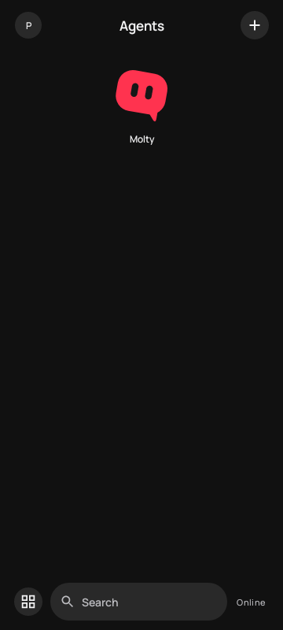
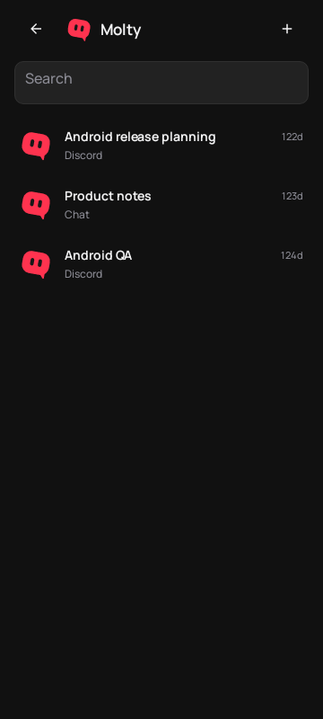
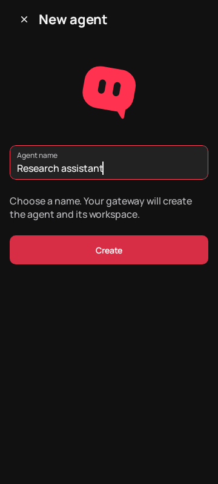

<div align="center">
  

  # ClawNova

  **Your OpenClaw agents, in your pocket.**

  A customized Android client for connecting to your OpenClaw Gateway,
  chatting with your agents, and keeping conversations organized.

  [Download for Android](https://github.com/RicchiutiDev/ClawNova/releases/latest) · [Getting started](#getting-started) · [Build from source](#build-from-source)

  Android 12+ · OpenClaw Gateway required · MIT licensed
</div>

---

## Meet ClawNova

ClawNova brings a redesigned interface to the OpenClaw Android client. Choose an agent on the home screen, open its conversations, and pick up where you left off. Each agent can have its own look, with customizable icon shapes and colors stored on your device.

- **Agents first** — browse your agents, open their chats, and create new agents when your Gateway supports it.
- **A focused chat experience** — write, attach files, and select the model and reasoning effort available to your session.
- **Your own look** — customize bot icons, appearance, and the app's theme.
- **Connect to your Gateway** — pair using a QR code, setup code, or a manual connection.
- **Designed for Android** — built with the native OpenClaw Android app and its existing Gateway protocol.

ClawNova is a client: you need an existing OpenClaw Gateway and a configured model provider to use its AI features. Creating an agent requires a compatible Gateway and `operator.admin` access.

## Screenshots

<table>
  <tr>
    <td align="center"><br><b>Agents</b></td>
    <td align="center"><br><b>Conversations</b></td>
    <td align="center"><br><b>New agent</b></td>
  </tr>
</table>

*Development previews rendered from the Android UI with sample data; these are not captures from a physical device and may differ from the 0.1 release.*

## Download

[**Download ClawNova 0.1 for Android →**](https://github.com/RicchiutiDev/ClawNova/releases/tag/v0.1)

Open the release page and download `ClawNova-0.1.apk`. The release also includes a SHA-256 checksum. The APK is signed with the ClawNova release key and requires **Android 12 or newer**.

The 0.1 release installs separately from the earlier ClawNova debug builds and the official OpenClaw app. Device-local settings and credentials are not migrated automatically. The previous Wear OS companion is not compatible with this release.

## Getting started

1. Set up and start an [OpenClaw Gateway](https://docs.openclaw.ai/start/getting-started) that your Android device can reach.
2. Download and install the APK from the [release page](https://github.com/RicchiutiDev/ClawNova/releases/tag/v0.1).
3. Open ClawNova and connect using your Gateway's QR code, setup code, or connection details.
4. Select an agent and start a conversation.

Gateway access, available models, and agent-management permissions depend on your OpenClaw configuration. Keep your Gateway credentials private and review the [OpenClaw security guide](https://docs.openclaw.ai/gateway/security) before exposing a Gateway remotely.

## The Standard edition

The published APK uses ClawNova's **Standard** flavor. It excludes SMS, call-log and accessibility-control implementations and removes the service for reading other apps' notifications. Chat notifications and the system attachment picker remain available.

The signed 0.1 build has passed release compilation and signature verification. It has not yet been tested on a physical device or against a real Gateway; hardware features and permissions depend on the device and server configuration.

## Build from source

This repository contains the wider OpenClaw source tree because the Android build uses shared packages and localization tools.

**Requirements:** JDK 21, the Android SDK with API 37, and the Node.js and pnpm versions specified in [`package.json`](package.json). Set `ANDROID_HOME` or configure `sdk.dir` in the local `apps/android/local.properties` file.

```bash
git clone https://github.com/RicchiutiDev/ClawNova.git
cd ClawNova
pnpm install --frozen-lockfile
cd apps/android
./gradlew :app:assembleStandardDebug
```

On Windows, run `gradlew.bat :app:assembleStandardDebug` in place of the last command. The debug APK is written under `apps/android/app/build/outputs/apk/standard/debug/`. You can also open `apps/android` in Android Studio after installing the repository dependencies.

The release application ID is `dev.ricchiutidev.clawnova`; debug builds append `.debug`. Release builds require a private signing key. Keep signing material out of the repository and back it up securely for future updates.

For the upstream Android project and other build variants, see the [Android development guide](apps/android/README.md).

## Credits and license

ClawNova is an independent customization based on [OpenClaw](https://github.com/openclaw/openclaw), starting from upstream commit [`936f38793bab7199ea2cbe11fb5ef559062254a1`](https://github.com/openclaw/openclaw/commit/936f38793bab7199ea2cbe11fb5ef559062254a1). Thank you to the OpenClaw Foundation and contributors for the original project.

The project retains the [MIT license](LICENSE) and [third-party notices](THIRD_PARTY_NOTICES.md).

